# ExamCraft Data Flow Diagrams

This document describes how data moves through the ExamCraft online
examination management system. The diagrams use Mermaid flowcharts:

- `E` indicates an external entity.
- `P` indicates a process.
- `D` indicates a data store.
- Arrows are labelled with the main data being transferred.

The flows are based on the backend route modules registered in
`backend/index.js` and the relational data stores defined in
`database/Examcraft_db_proto.sql`.

## 1. Context-Level DFD

ExamCraft is represented as one system. External users exchange requests,
configuration, exam data, answers, and reports with the system.

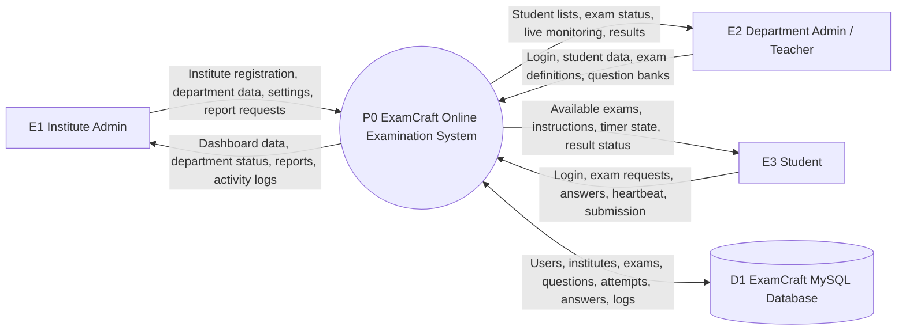

## 2. Level 1 DFD: Main System Processes

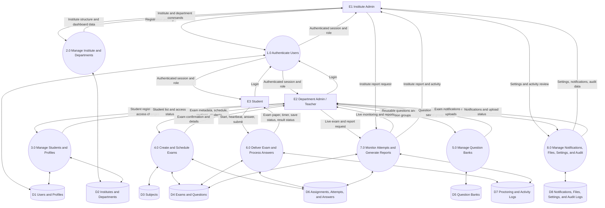

## 3. Authentication and Authorization DFD

Relevant routes include `/api/auth/login`, registration endpoints,
`/api/auth/verify`, and the shared authentication middleware.

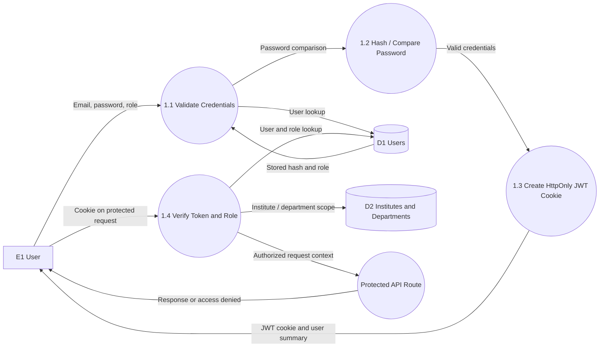

## 4. Institute Administration DFD

This flow covers institute creation, department administration, dashboard
statistics, settings, activity data, and institute reports.

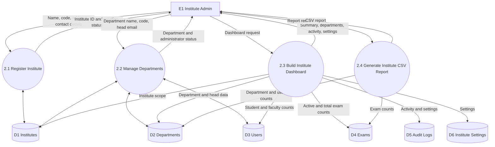

## 5. Department Administration and Exam Authoring DFD

Relevant routes include `/api/department`, `/api/department/dashboard`, and
the exam creation and update routes under `/api/exams`.

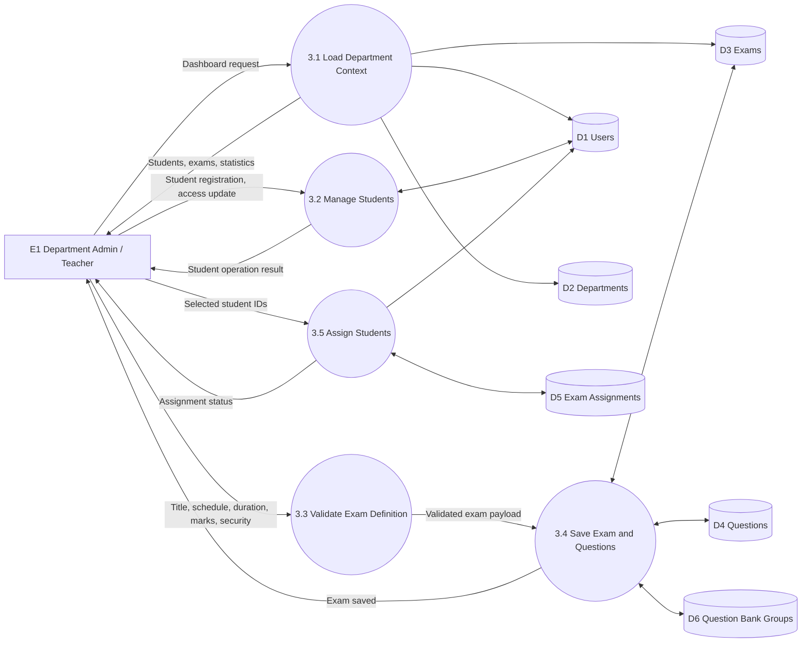

## 6. Question Bank DFD

Relevant routes are `GET /api/question-banks` and `POST /api/question-banks`.

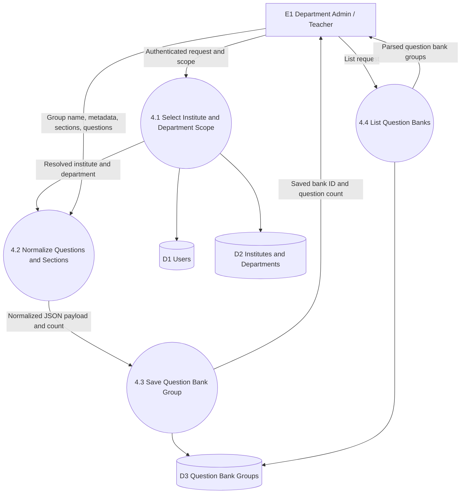

## 7. Student Exam Delivery DFD

Relevant routes include exam instructions, start, status, heartbeat,
save-answer, and submit endpoints under `/api/exams/:examId`.

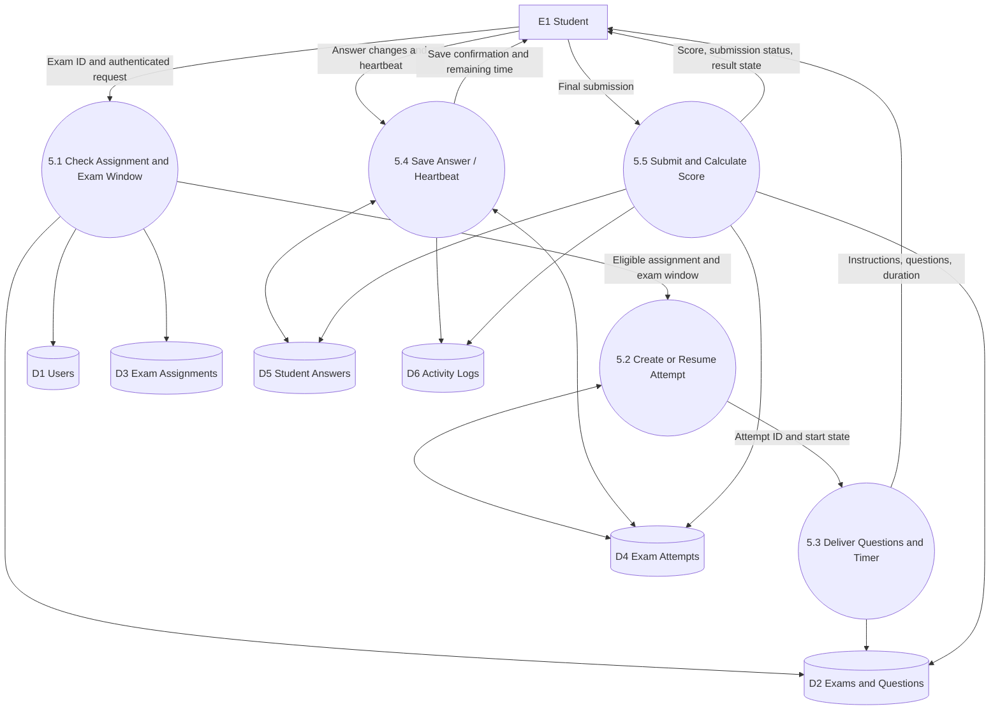

## 8. Live Monitoring and Reporting DFD

This flow covers department live-exam monitoring, forced submission, exam
reports, and institute-level reporting.

```mermaid
flowchart LR
    DA["E1 Department Admin / Teacher"]
    IA["E2 Institute Admin"]
    P61(("6.1 Aggregate Live Attempt State"))
    P62(("6.2 Force Submit Attempt"))
    P63(("6.3 Generate Exam Report"))
    P64(("6.4 Generate Institute Report"))
    D61[("D1 Exams")]
    D62[("D2 Users and Departments")]
    D63[("D3 Assignments and Attempts")]
    D64[("D4 Answers and Results")]
    D65[("D5 Activity and Audit Logs")]

    DA -->|"Live dashboard request"| P61
    P61 --> D61
    P61 --> D63
    P61 --> D65
    P61 -->|"Active students, progress, violations"| DA

    DA -->|"Exam ID and student ID"| P62
    P62 <--> D63
    P62 --> D64
    P62 --> D65
    P62 -->|"Force-submit result"| DA

    DA -->|"Exam report request"| P63
    P63 --> D61
    P63 --> D63
    P63 --> D64
    P63 -->|"Exam results and analytics"| DA

    IA -->|"Institute report request"| P64
    P64 --> D62
    P64 --> D61
    P64 -->|"Department, student, faculty, and active-exam CSV"| IA
```

## 9. Coding Execution DFD

Coding questions use the `/api/run` route and store submissions alongside the
student's exam attempt.

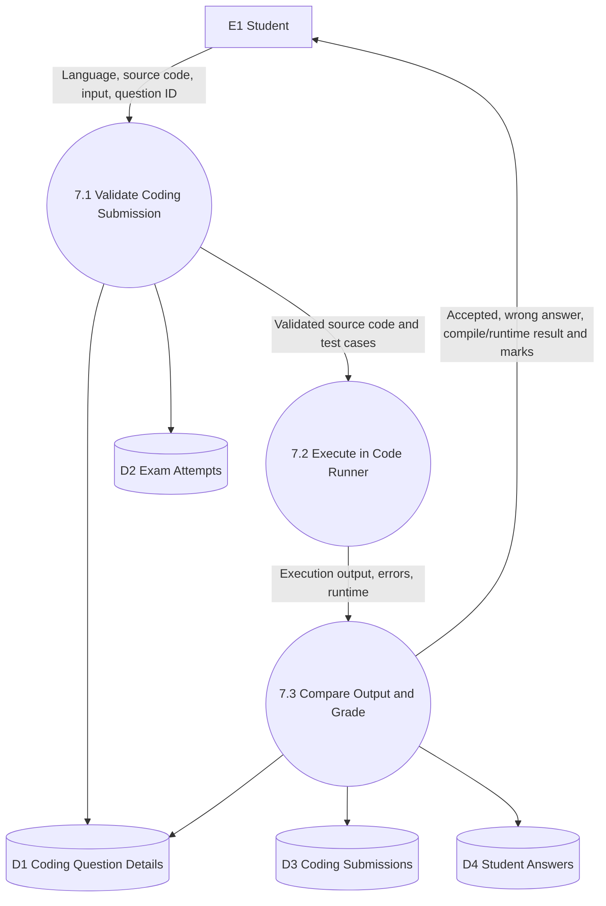

## 10. Supporting Services DFD

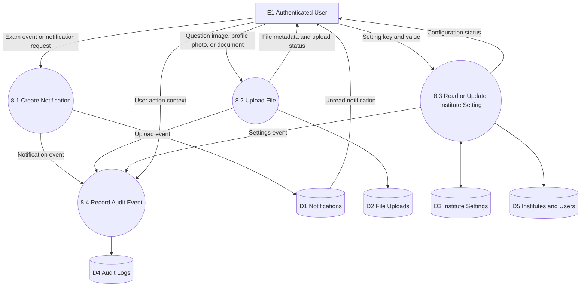

## 11. Main End-to-End Data Flow

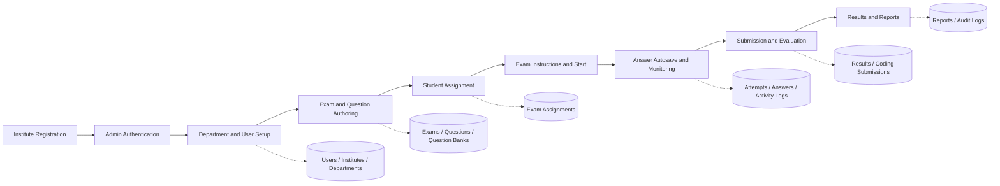

## 12. Data Store Catalogue

| ID | Data store | Main tables | Purpose |
|---|---|---|---|
| D1 | Identity data | `users`, `user_profiles` | Credentials, roles, profiles, and access state |
| D2 | Organization data | `institutes`, `departments`, `subjects` | Institute hierarchy and academic subjects |
| D3 | Exam authoring data | `exams`, `questions`, `question_types` | Exam metadata and question papers |
| D4 | Question bank data | `question_bank`, `question_bank_groups` | Reusable questions and saved groups |
| D5 | Assignment data | `exam_assignments` | Students assigned to exams |
| D6 | Attempt data | `exam_attempts`, `student_answers` | Timers, submissions, answers, and marks |
| D7 | Monitoring data | `exam_proctoring_settings`, `student_activity_logs` | Security configuration and activity events |
| D8 | Coding data | `coding_question_details`, `coding_submissions` | Coding constraints, source code, and execution results |
| D9 | Supporting data | `notifications`, `exam_sessions`, `file_uploads` | Messages, lab sessions, and uploaded files |
| D10 | Governance data | `institute_settings`, `audit_logs` | Configuration and administrative traceability |

## 13. API-to-Process Mapping

| API route group | DFD process |
|---|---|
| `/api/auth/*` | 1.0 Authenticate Users |
| `/api/institute` | 2.0 Manage Institute and Departments |
| `/api/institute/dashboard/*` | 2.0 and 7.0 Dashboard and Reporting |
| `/api/department` | 2.0 Manage Institute and Departments |
| `/api/department/dashboard/*` | 3.0, 7.0 Student Management and Monitoring |
| `/api/exams` | 4.0, 6.0, and 7.0 Exam Authoring, Delivery, and Reporting |
| `/api/question-banks` | 5.0 Manage Question Banks |
| `/api/student/dashboard` | 6.0 Deliver Exam and Process Answers |
| `/api/user` | 1.0 and 3.0 Authentication and User Profiles |
| `/api/run` | Coding Execution DFD |
