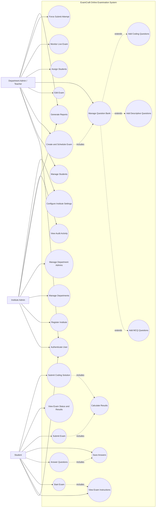

# ExamCraft Use Case Diagram

## System Overview

ExamCraft is an online examination management system used by institute administrators, department administrators or teachers, and students.

## Actors

### Institute Administrator

- Authenticate user
- Register and manage institute
- Manage departments
- Create department administrators
- View institute dashboard
- View activity logs
- Generate institute reports
- Configure institute settings

### Department Administrator / Teacher

- Authenticate user
- Manage students
- Update student access
- Create and schedule exams
- Edit exam details
- Create question banks
- Add MCQ questions
- Add descriptive questions
- Add coding questions
- Assign students to exams
- Monitor live examinations
- Force-submit an attempt
- View exam reports

### Student

- Authenticate user
- View available exams
- View exam instructions
- Start an exam
- Answer questions
- Save answers
- Navigate questions
- Submit an exam
- View exam status and results
- Submit coding solutions

## Use Case Diagram

## Use Case Relationships

- Authentication is required before accessing protected features.
- Creating an exam includes selecting or creating its question content.
- A question bank can contain MCQ, descriptive, and coding questions.
- Starting an exam includes viewing exam instructions.
- Answering questions includes saving answers.
- Submitting an exam includes result calculation.
- Coding submissions are evaluated as part of result processing.
- Department administrators can monitor active attempts and force-submit them when required.
- Institute administrators and department teachers can generate reports according to their authorization scope.
