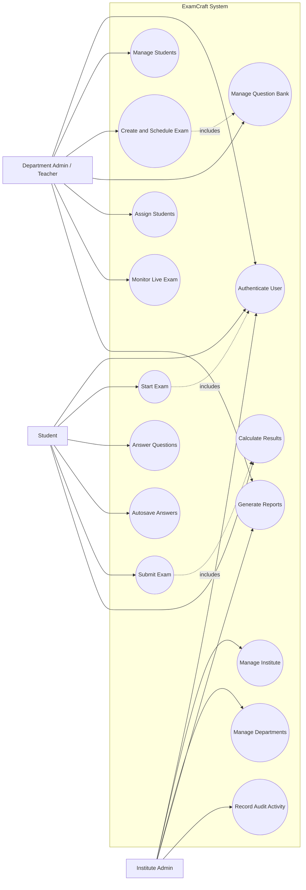

Updated todo list

## Slide 1: Project Description

### ExamCraft: Online Examination Management System

ExamCraft is a full-stack web application designed to manage online examinations for educational institutes.

**Main users:**
- Institute Administrator
- Department Administrator/Teacher
- Student

**Key functions:**
- Institute and department management
- Student and faculty management
- Exam creation and scheduling
- Question bank management
- Student assignment and exam attempts
- Online submission and result processing
- Live monitoring and reporting

**Objective:**  
To provide a secure, centralized, and efficient platform for managing the complete examination lifecycle.

---

## Slide 2: Technology Stack

### Frontend
- React.js
- Vite
- React Router
- Tailwind CSS
- Context API
- JavaScript and JSX

### Backend
- Node.js
- Express.js
- RESTful APIs
- JWT authentication
- Cookie-based sessions
- bcryptjs for password hashing

### Database
- MySQL
- mysql2 database driver
- JSON fields for questions, answers, and sections

### Development and Deployment
- Docker
- Docker Compose
- Nodemon
- Git and GitHub
- dotenv for environment configuration

---

## Slide 3: APIs and Libraries Used

### Authentication APIs
- `POST /api/auth/login`
- `POST /api/auth/institute-admin-register`
- `POST /api/auth/department-admin-register`
- `POST /api/auth/student-register`
- `GET /api/auth/verify`

### Institute and Department APIs
- `POST /api/institute`
- `GET /api/institute/dashboard`
- `GET /api/institute/dashboard/report`
- `POST /api/department`
- `GET /api/department/dashboard`
- `GET /api/department/dashboard/students`

### Examination APIs
- `GET /api/exams`
- `POST /api/exams`
- `GET /api/exams/:examId`
- `PATCH /api/exams/:examId`
- `POST /api/exams/:examId/start`
- `POST /api/exams/:examId/save-answer`
- `POST /api/exams/:examId/submit`
- `GET /api/exams/:examId/report`

### Question Bank APIs
- `GET /api/question-banks`
- `POST /api/question-banks`

### Libraries and Purpose
- **React:** User interface development
- **Express.js:** Backend routing and middleware
- **MySQL2:** MySQL connectivity
- **JWT:** Secure authentication
- **bcryptjs:** Password encryption
- **Tailwind CSS:** Responsive styling
- **React Router:** Role-based navigation
- **Docker:** Containerized deployment
- **CORS:** Frontend-backend communication
- **dotenv:** Environment variable management

---

## Slide 4: Use Case Diagram

### Actors

**Institute Administrator**
- Register institute
- Manage departments
- Create department administrators
- View institute dashboard
- Generate reports
- View audit activity

**Department Administrator/Teacher**
- Manage students
- Create and edit exams
- Create question banks
- Add MCQ, descriptive, and coding questions
- Assign students
- Monitor live exams
- View exam reports

**Student**
- Login
- View available exams
- Read exam instructions
- Start exam
- Answer questions
- Save answers
- Submit exam
- View result status

### Use Case Diagram

---

## Slide 5: Security Features

- Role-based authentication for institute admins, department admins, and students
- JWT-based authentication
- HttpOnly cookies for secure session handling
- Password hashing using bcryptjs
- Protected backend routes
- Authorization middleware
- Institute and department data isolation
- Input validation and error handling
- CORS configuration
- Exam time limits and automatic submission
- Exam assignment validation
- Safe Exam Browser support
- Copy and paste restrictions
- Right-click and text-selection restrictions
- Tab-switch and fullscreen monitoring
- Audit logs for administrative actions
- Activity tracking during exam attempts
- Secure coding-question execution flow

---

## Slide 6: Advantages and Future Scope

### Advantages

- Centralized examination management
- Reduces paperwork and manual effort
- Faster exam creation and evaluation
- Secure role-based access
- Easy student and department management
- Real-time exam monitoring
- Automated answer saving
- Improved result reporting
- Reusable question banks
- Supports MCQ, descriptive, and coding questions
- Scalable full-stack architecture

### Future Scope

- Email and SMS notifications
- AI-assisted question generation
- Advanced performance analytics
- Online video proctoring
- Facial recognition-based verification
- Mobile application
- Automated certificate generation
- Enhanced coding sandbox
- Detailed student performance reports
- Integration with college ERP systems
- Multi-language examination support
- Cloud deployment and auto-scaling

---

## Slide 7: Conclusion

ExamCraft provides a complete digital solution for managing online examinations.

It connects institute administrators, department teachers, and students through a single secure platform.

The system simplifies:

- Institute administration
- Exam creation
- Question bank management
- Student assignment
- Secure exam delivery
- Answer processing
- Result generation
- Reporting and monitoring

With its role-based architecture, secure authentication, MySQL database, and scalable REST APIs, ExamCraft can significantly improve the efficiency, security, and reliability of modern examination management.