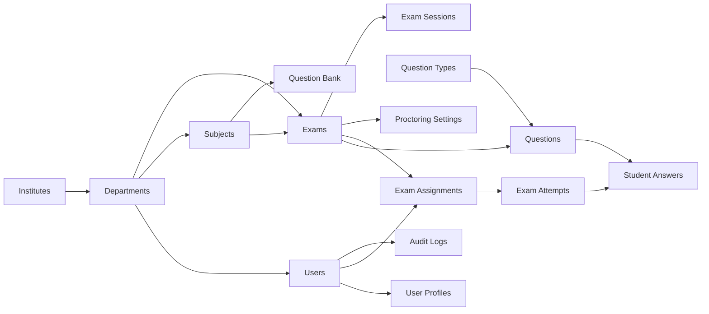
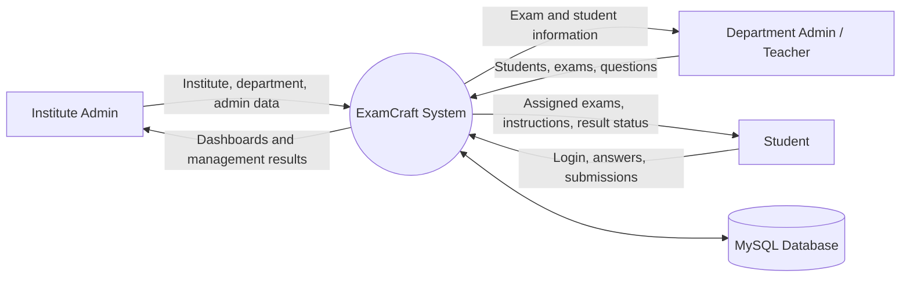
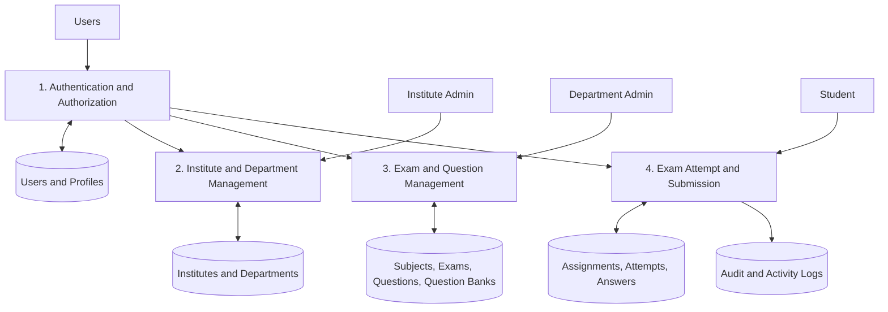
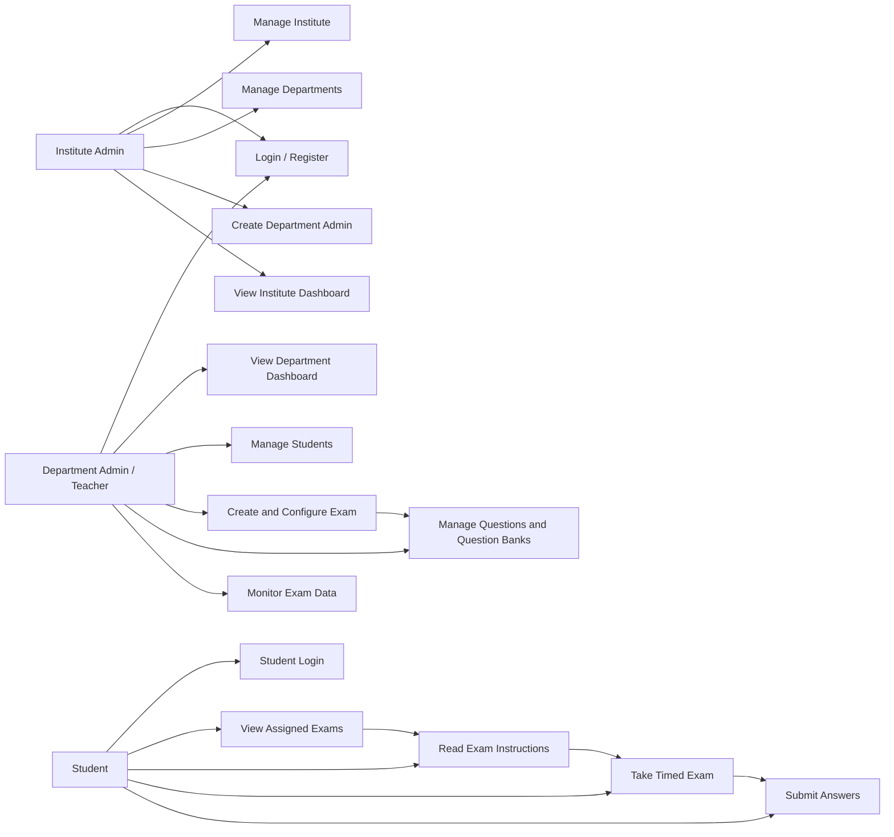

# ExamCraft - Presentation Content

> Ready-to-use content for project presentation and viva. Replace bracketed fields such as `[College Name]` with your details.

## 1. Project Title

**ExamCraft: Online Examination Management System**

**Presented by:** [Student Name / Team Names]  
**Course:** MCA - 3rd Semester  
**Institute:** [College / University Name]  
**Guide:** [Guide Name]

## 2. Project Description

ExamCraft is a role-based web application for managing online examinations in educational institutes. It connects institute administrators, department administrators/teachers, and students through one centralized platform.

The system supports institute and department setup, user management, exam creation, question-bank management, student assignment, exam instructions, timed examination, answer submission, and role-specific dashboards. Authentication and protected routes ensure that each user can access only the features allowed for their role.

### Main Objectives

- Digitize the complete examination workflow.
- Reduce manual work in exam creation and student management.
- Provide a consistent and responsive exam-taking interface.
- Organize institutes, departments, subjects, exams, questions, attempts, and answers in a relational database.
- Provide a foundation for secure and proctored examinations.

### User Roles

| Role | Main responsibilities |
|---|---|
| Institute Admin | Manage institute details, departments, and department administrators |
| Department Admin / Teacher | Manage students, create exams, configure questions, and monitor department activity |
| Student | Log in, view assigned exams, read instructions, attempt exams, and submit answers |

## 3. Technology Stack

| Layer | Technologies |
|---|---|
| Frontend | React 19, Vite, React Router, Tailwind CSS, PostCSS |
| Backend | Node.js, Express.js |
| Database | MySQL with `mysql2` |
| Authentication | JWT-based authentication delivered through an HttpOnly cookie, cookie-parser, bcrypt |
| Validation | Joi |
| API style | REST API with JSON request/response bodies |
| Code editor | Monaco Editor React integration for coding-question support |
| Development | npm, ESLint, Docker/Docker Compose |
| Navigation | React Router with `HashRouter` |

## 4. Datasets / APIs / Libraries Used

### Dataset

ExamCraft does not depend on an external public dataset. Its operational data is entered by institute administrators, department administrators/teachers, and students, and is stored in the project MySQL database.

The database includes institutes, departments, users, profiles, subjects, exams, questions, question banks, assignments, attempts, answers, notifications, audit logs, and proctoring/activity records.

### Important APIs

| Method | Endpoint | Purpose |
|---|---|---|
| POST | `/api/auth/institute-admin-register` | Register an institute administrator |
| POST | `/api/auth/department-admin-register` | Register a department administrator |
| POST | `/api/auth/student-register` | Register a student |
| POST | `/api/auth/login` | Authenticate a user and set the HttpOnly cookie |
| GET | `/api/auth/verify` | Verify the current authenticated session |
| POST | `/api/institute` | Create an institute |
| POST | `/api/department` | Create a department |
| GET | `/api/user/getuserdata` | Fetch authenticated user data |
| GET / POST | `/api/exams` | List or create exams |
| GET / POST | `/api/question-banks` | Work with reusable question banks |
| GET | `/api/institute/dashboard` | Institute dashboard data |
| GET | `/api/department/dashboard` | Department dashboard data |
| GET | `/api/student/dashboard` | Student dashboard data |
| POST | `/api/run` | Run/compile supported coding-question submissions |

### Libraries

- `react`, `react-dom`, `react-router-dom`
- `express`, `cors`, `cookie-parser`, `dotenv`
- `mysql2`, `bcrypt`, `jsonwebtoken`, `joi`
- `@monaco-editor/react` for an editor-based coding interface
- `vite`, `tailwindcss`, `postcss`, and `eslint`

## 5. SRS (Software Requirements Specification)

### 5.1 Functional Requirements

**FR-01: Authentication**  
The system shall allow institute administrators, department administrators, and students to register or log in using role-specific credentials. A successful login shall create an authenticated session using a JWT stored in an HttpOnly cookie.

**FR-02: Authorization**  
The system shall protect dashboard and examination routes using role-based route protection.

**FR-03: Institute Management**  
The institute administrator shall be able to create and manage departments and department-level accounts.

**FR-04: Student Management**  
The department administrator shall be able to add and manage students belonging to the department.

**FR-05: Exam Management**  
The department administrator shall be able to create exams, configure title, description, timing, duration, marks, status, subject, instructions, and exam mode.

**FR-06: Question Management**  
The system shall support question types such as MCQ, true/false, descriptive, and coding questions. Questions may contain options, correct answers, marks, explanations, and ordering information.

**FR-07: Question Banks**  
The system shall support reusable question banks and question-bank groups for organizing questions by subject, difficulty, tags, or exam source.

**FR-08: Student Examination**  
The student shall be able to view assigned exams, read exam instructions, select answers, navigate questions, and submit an attempt.

**FR-09: Attempts and Answers**  
The system shall record exam attempts, selected answers, marks, review status, submission status, and timing information.

**FR-10: Audit and Activity Tracking**  
The system shall support audit logs and student activity records for actions such as tab switching, window blur, copy/paste, right-click, and inactivity warnings where configured.

### 5.2 Non-Functional Requirements

- **Security:** Password hashing, HttpOnly session cookie, protected routes, role checks, CORS credentials, and input validation.
- **Performance:** Dashboard and exam pages should remain responsive for normal institute usage and concurrent student activity.
- **Reliability:** Exam and answer data should be persisted in MySQL and protected by foreign-key relationships.
- **Usability:** The interface should provide separate, simple workflows for each role.
- **Maintainability:** Frontend, backend routes, models/schema, and shared utilities are separated into modules.
- **Compatibility:** The web application should work in current Chrome, Edge, and Firefox versions.
- **Scalability:** The normalized relational schema and indexed foreign keys provide a base for adding more institutes, departments, users, and exams.

### 5.3 Scope and Future Enhancements

The current project includes role dashboards, registration/login flows, exam creation/configuration, question-bank support, student exam flow, coding support, and database structures for proctoring and activity logging. Full email password reset, production HTTPS deployment, advanced analytics, and complete automated E2E testing can be presented as future enhancements unless they are demonstrated in the running build.

## 6. ER Diagram

The following Mermaid ER diagram is based on the implemented SQL schema. Paste it into a Mermaid-compatible Markdown viewer or Mermaid Live Editor to render it.

```mermaid
erDiagram
    INSTITUTES ||--o{ DEPARTMENTS : contains
    INSTITUTES ||--o{ USERS : owns
    DEPARTMENTS ||--o{ USERS : has
    USERS ||--o| USER_PROFILES : extends
    DEPARTMENTS ||--o{ SUBJECTS : offers
    DEPARTMENTS ||--o{ EXAMS : conducts
    SUBJECTS ||--o{ EXAMS : categorizes
    USERS ||--o{ EXAMS : creates
    EXAMS ||--o{ QUESTIONS : contains
    QUESTION_TYPES ||--o{ QUESTIONS : classifies
    SUBJECTS ||--o{ QUESTION_BANK : groups
    QUESTION_TYPES ||--o{ QUESTION_BANK : classifies
    USERS ||--o{ QUESTION_BANK : creates
    EXAMS ||--o{ EXAM_ASSIGNMENTS : assigned_as
    USERS ||--o{ EXAM_ASSIGNMENTS : receives
    EXAM_ASSIGNMENTS ||--o{ EXAM_ATTEMPTS : allows
    EXAM_ATTEMPTS ||--o{ STUDENT_ANSWERS : records
    QUESTIONS ||--o{ STUDENT_ANSWERS : answered_in
    EXAMS ||--o{ EXAM_SESSIONS : schedules
    EXAMS ||--o| EXAM_PROCTORING_SETTINGS : configures
    USERS ||--o{ AUDIT_LOGS : generates

    INSTITUTES { int institute_id PK; string name; string code }
    DEPARTMENTS { int department_id PK; int institute_id FK; string name; string code }
    USERS { int user_id PK; int institute_id FK; int department_id FK; string email; enum role }
    SUBJECTS { int subject_id PK; int department_id FK; string subject_code; string name }
    EXAMS { int exam_id PK; int department_id FK; int subject_id FK; int created_by FK; string title; enum status }
    QUESTIONS { int question_id PK; int exam_id FK; int type_id FK; text question_text; json options }
    EXAM_ASSIGNMENTS { int assignment_id PK; int exam_id FK; int student_id FK }
    EXAM_ATTEMPTS { int attempt_id PK; int assignment_id FK; int student_id FK; decimal total_score; boolean is_submitted }
    STUDENT_ANSWERS { int answer_id PK; int attempt_id FK; int question_id FK; json selected_answer }
```

## 7. Schema Diagram

This simplified schema diagram shows the main data flow through the database tables. The full table definitions are available in `database/Examcraft_db_proto.sql`.



### Core Table Summary

| Table | Purpose |
|---|---|
| `institutes` | Stores institute master data |
| `departments` | Stores departments belonging to an institute |
| `users` | Stores all role-based accounts |
| `subjects` | Stores department subjects/courses |
| `exams` | Stores exam configuration and lifecycle status |
| `questions` | Stores exam questions and answer data |
| `exam_assignments` | Maps exams to students |
| `exam_attempts` | Stores each student's exam attempt |
| `student_answers` | Stores answers and marks per question |
| `question_bank` | Stores reusable questions |
| `audit_logs` | Records administrative actions |
| `exam_proctoring_settings` | Stores exam monitoring rules |

## 8. Data Flow Diagrams (DFDs)

### 8.1 Context-Level DFD



### 8.2 Level-1 DFD



## 9. Use Case Diagram



### Use Case Notes

| Use case | Actor | Result |
|---|---|---|
| Login | All roles | Authenticated role-specific session |
| Manage departments | Institute Admin | Department records and department admins are maintained |
| Create exam | Department Admin | Exam configuration is saved for student assignment/use |
| Manage questions | Department Admin | Questions are added to exams or reusable banks |
| Take exam | Student | Student answers are recorded against an attempt |
| Submit exam | Student | Attempt is marked submitted and answer data is persisted |

## 10. Screenshots of Implemented Features

Actual screenshots cannot be embedded from source code alone; they must be captured from the running frontend so that the presentation shows the real UI. Use the following capture list. Save images in `doc/screenshots/` and replace each placeholder path with the captured filename.

| No. | Screenshot to capture | Suggested file | Frontend route |
|---:|---|---|---|
| 1 | Landing page / role selection | `01-landing.png` | `#/` |
| 2 | Institute administrator login | `02-institute-login.png` | `#/login` |
| 3 | Student login | `03-student-login.png` | `#/student-login` |
| 4 | Institute dashboard | `04-institute-dashboard.png` | `#/institute-dashboard` |
| 5 | Department dashboard | `05-department-dashboard.png` | `#/department-dashboard` |
| 6 | Add student modal/form | `06-student-management.png` | Department dashboard workflow |
| 7 | Create exam page | `07-create-exam.png` | `#/department-exams/new` |
| 8 | Exam settings page | `08-exam-settings.png` | `#/department-exams/:examId/settings` |
| 9 | Question bank interface | `09-question-bank.png` | Department question-bank workflow |
| 10 | Student dashboard with available exams | `10-student-dashboard.png` | `#/student-dashboard` |
| 11 | Exam instructions page | `11-exam-instructions.png` | `#/exam/:examId/instructions` |
| 12 | Exam interface with timer/questions | `12-exam-interface.png` | `#/exam/:examId` |

### Screenshot Capture Checklist

1. Start MySQL, backend, and frontend according to the root README.
2. Open the Vite URL, log in with test accounts, and capture each role's working screen.
3. Hide passwords, tokens, personal phone numbers, and private database data before inserting images into slides.
4. Use the same browser size for all screenshots, preferably 1366x768 or 1920x1080.
5. Add a short caption below each image, for example: `Figure 7: Department administrator creates a new examination.`

## Presentation Closing Summary

ExamCraft provides a complete foundation for secure digital examination management. Its role-based architecture separates institute, department, and student responsibilities; its React and Express layers communicate through REST APIs; and its normalized MySQL schema preserves the relationships between exams, questions, assignments, attempts, and answers. The system can be extended with analytics, notifications, advanced proctoring, password reset, and production deployment controls.
