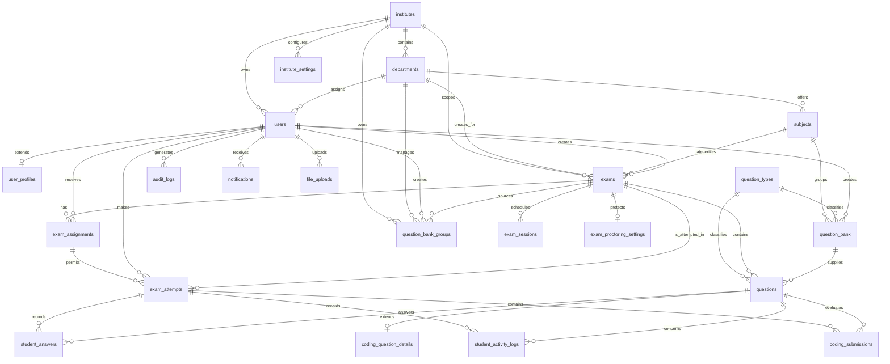
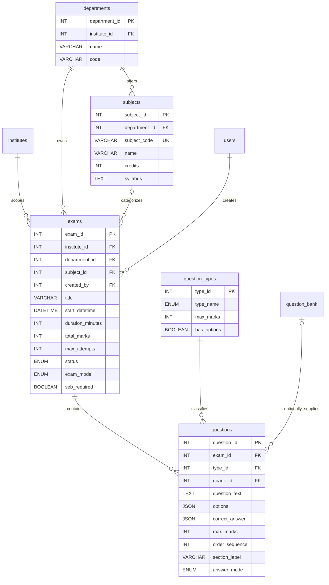
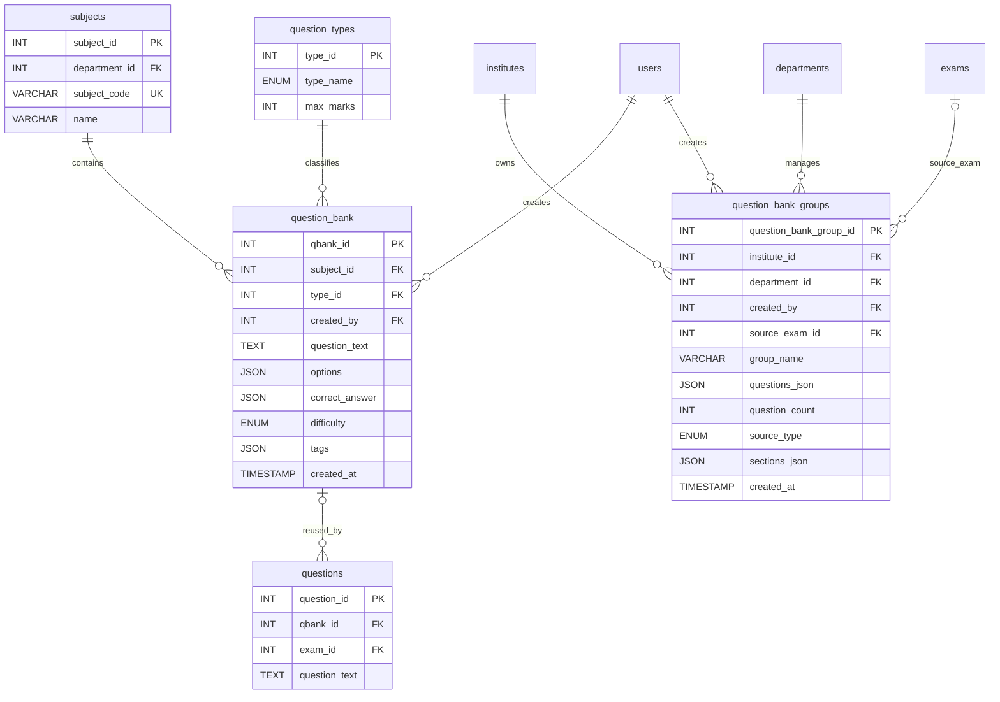
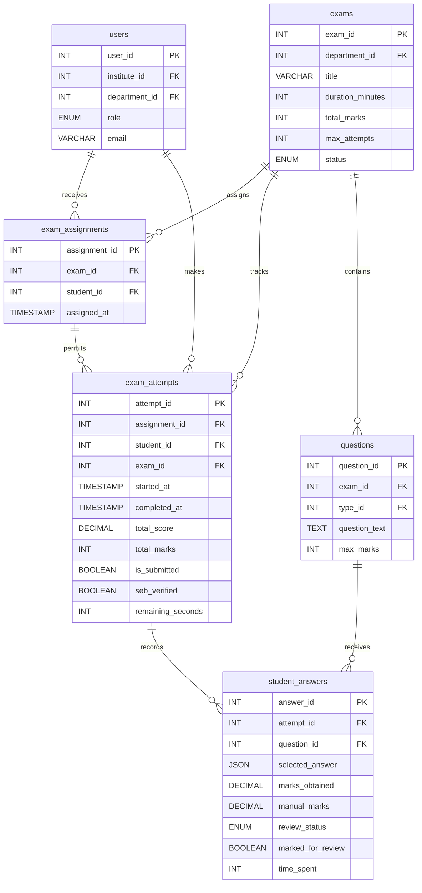
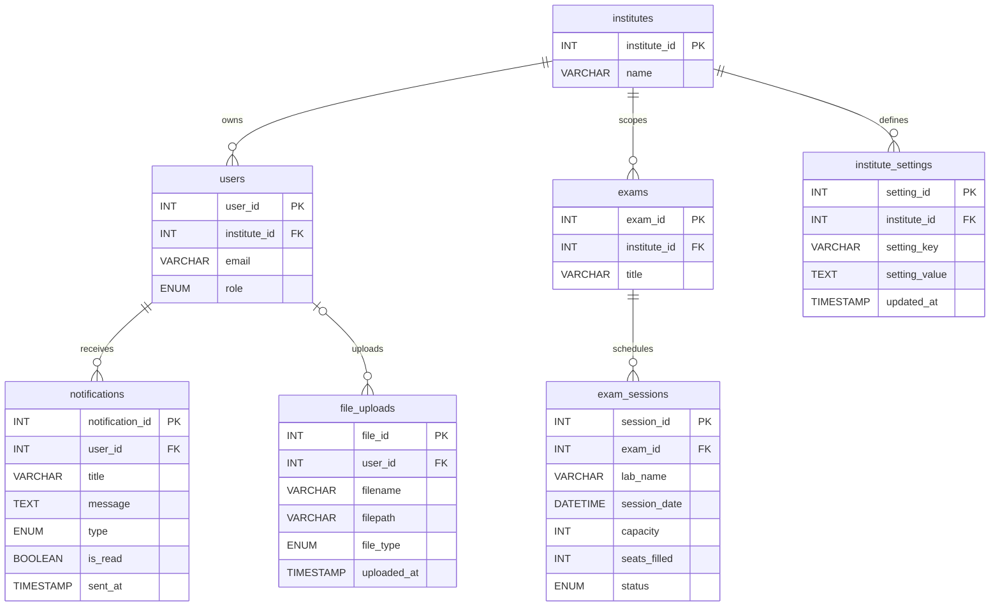

# ExamCraft ER Diagrams

This document describes the database relationships implemented in
`database/Examcraft_db_proto.sql`. The diagrams are split by functional
section so they can be used independently in a project presentation.

## 1. Complete ER Overview



## 2. Institute, Department, and User Management

This module supports institute registration, department administration,
role-based users, and optional profile details.

```mermaid
erDiagram
    institutes {
        INT institute_id PK
        VARCHAR name
        VARCHAR code UK
        TEXT address
        VARCHAR contact_email
        VARCHAR phone
        TIMESTAMP created_at
    }
    departments {
        INT department_id PK
        INT institute_id FK
        VARCHAR name
        VARCHAR code
        VARCHAR head_email
        TIMESTAMP created_at
    }
    users {
        INT user_id PK
        INT institute_id FK
        INT department_id FK
        VARCHAR email UK
        VARCHAR password_hash
        ENUM role
        VARCHAR first_name
        VARCHAR last_name
        BOOLEAN is_active
        TIMESTAMP last_login
    }
    user_profiles {
        INT user_id PK_FK
        VARCHAR enrollment_no UK
        VARCHAR employee_id
        DATE date_of_birth
        ENUM gender
        VARCHAR profile_image
    }
    institutes ||--o{ departments : contains
    institutes ||--o{ users : owns
    departments o|--o{ users : assigns
    users ||--o| user_profiles : has
```

Relationship notes:

- An institute can have many departments and users.
- A department belongs to one institute and can contain many users.
- `users.department_id` is nullable for institute administrators.
- `user_profiles` is a one-to-one extension of `users`.

## 3. Subjects, Exams, and Question Authoring

This module models the department's academic structure and the exam paper.



Relationship notes:

- An exam is owned by one institute and one department.
- A department can offer many subjects and create many exams.
- An exam contains ordered questions; deleting an exam deletes its questions.
- `qbank_id` is optional because questions may be authored directly in an exam.

## 4. Reusable Question Bank Module

The project has both individual reusable questions and saved question-bank
groups generated manually or from an exam.



Relationship notes:

- `question_bank` stores reusable, subject-specific questions.
- `question_bank_groups` stores a reusable JSON snapshot and can optionally
  reference the exam from which it was generated.
- A question can reference a reusable bank entry, but the reference is
  nullable for manually authored questions.

## 5. Exam Assignment, Attempt, and Evaluation Module

This module represents the student exam lifecycle from assignment through
answers and scoring.



Relationship notes:

- `exam_assignments` resolves the many-to-many relationship between exams and
  students.
- An assigned student can make multiple attempts, subject to `max_attempts`.
- Each attempt can have one answer row per question through the unique
  `(attempt_id, question_id)` constraint.

## 6. Coding Question and Submission Module

Coding questions extend the base question record and allow students to submit
source code during an attempt.

```mermaid
erDiagram
    questions {
        INT question_id PK
        INT exam_id FK
        INT type_id FK
        TEXT question_text
        INT max_marks
    }
    coding_question_details {
        INT coding_detail_id PK
        INT question_id UK_FK
        ENUM language_type
        TEXT starter_code
        TEXT sample_input
        TEXT sample_output
        JSON hidden_test_cases
        JSON visible_test_cases
        INT time_limit_ms
        INT memory_limit_mb
    }
    exam_attempts {
        INT attempt_id PK
        INT student_id FK
        INT exam_id FK
        BOOLEAN is_submitted
    }
    coding_submissions {
        INT submission_id PK
        INT attempt_id FK
        INT question_id FK
        ENUM language_type
        MEDIUMTEXT source_code
        MEDIUMTEXT stdout
        MEDIUMTEXT stderr
        ENUM status
        DECIMAL marks_obtained
        TIMESTAMP submitted_at
    }
    questions ||--o| coding_question_details : defines
    exam_attempts ||--o{ coding_submissions : contains
    questions ||--o{ coding_submissions : receives
```

Relationship notes:

- Only coding questions need a `coding_question_details` row.
- A coding question can receive multiple submissions during an attempt.
- Submission status records pending, running, accepted, compilation, runtime,
  time-limit, and wrong-answer outcomes.

## 7. Security, Proctoring, and Activity Monitoring

These tables support Safe Exam Browser checks, proctoring configuration, and
student activity auditing.

```mermaid
erDiagram
    exams {
        INT exam_id PK
        BOOLEAN seb_required
        VARCHAR seb_quit_password
    }
    exam_proctoring_settings {
        INT setting_id PK
        INT exam_id UK_FK
        BOOLEAN block_copy_paste
        BOOLEAN block_right_click
        BOOLEAN detect_tab_switch
        BOOLEAN detect_window_blur
        BOOLEAN detect_fullscreen_exit
        INT inactivity_timeout_seconds
        INT max_idle_warnings
    }
    exam_attempts {
        INT attempt_id PK
        INT exam_id FK
        INT student_id FK
        BOOLEAN seb_verified
        VARCHAR user_agent
        TIMESTAMP last_activity_at
        INT idle_warning_count
        INT tab_switch_count
        INT fullscreen_exit_count
    }
    questions {
        INT question_id PK
        INT exam_id FK
        TEXT question_text
    }
    student_activity_logs {
        INT activity_id PK
        INT attempt_id FK
        INT question_id FK
        ENUM activity_type
        TEXT activity_value
        TIMESTAMP activity_time
        VARCHAR ip_address
        VARCHAR user_agent
    }
    users {
        INT user_id PK
        VARCHAR email
        ENUM role
    }
    audit_logs {
        INT log_id PK
        INT user_id FK
        VARCHAR action
        VARCHAR table_name
        INT record_id
        JSON old_values
        JSON new_values
        TIMESTAMP created_at
    }
    exams ||--o| exam_proctoring_settings : configures
    exams ||--o{ exam_attempts : protects
    exam_attempts ||--o{ student_activity_logs : emits
    questions o|--o{ student_activity_logs : concerns
    users o|--o{ audit_logs : generates
```

Relationship notes:

- Proctoring settings are one-to-one with an exam.
- Activity logs belong to an attempt; `question_id` is nullable for exam-level
  events such as tab switches or fullscreen exits.
- Audit logs can be system-generated, so `audit_logs.user_id` is nullable.

## 8. Notifications, Sessions, Files, and Institute Settings

This supporting module handles communication, lab sessions, uploaded assets,
and institute-wide configuration.



Relationship notes:

- Notifications belong to individual users and support scheduled exam,
  reminder, and result-ready messages.
- An exam can have multiple lab sessions with capacity and seat tracking.
- Files may be attached to a user and can represent question images, profile
  photos, or documents.
- Institute settings use `(institute_id, setting_key)` as a unique pair.

## 9. Referential Integrity Summary

| Relationship | Cardinality | Delete behavior |
|---|---:|---|
| Institute to Department | 1:N | Cascade departments when an institute is deleted |
| Institute to User | 1:N | Cascade users when an institute is deleted |
| Department to User | 1:N | Set `department_id` to NULL when a department is deleted |
| Exam to Question | 1:N | Cascade questions when an exam is deleted |
| Exam to Student | M:N | Resolved by `exam_assignments` |
| Assignment to Attempt | 1:N | Attempts retain assignment history |
| Attempt to Answer | 1:N | Cascade answers when an attempt is deleted |
| Question to Coding Details | 1:0..1 | Cascade coding details when a question is deleted |
| Exam to Proctoring Settings | 1:0..1 | Cascade settings when an exam is deleted |
| Attempt to Activity Log | 1:N | Cascade activity logs when an attempt is deleted |
| Institute to Settings | 1:N | Unique per institute and setting key |

## 10. Implementation Notes

- JSON columns such as `options`, `correct_answer`, `sections_json`, and
  `questions_json` intentionally keep flexible exam content inside relational
  entities.
- `exams.sections_json` and the question-bank group JSON fields are embedded
  structures, not separate tables in the current schema.
- The SQL file contains later `ALTER TABLE` statements that add subject,
  question-bank, answer-mode, and monitoring fields. A fresh database should
  execute the complete SQL file in order.
- The schema uses `question_types.type_name` values defined by SQL. The
  frontend may display equivalent labels such as MCQ, descriptive, and coding.